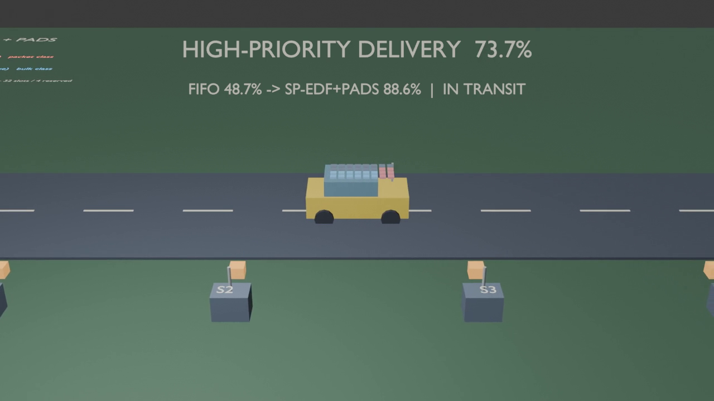
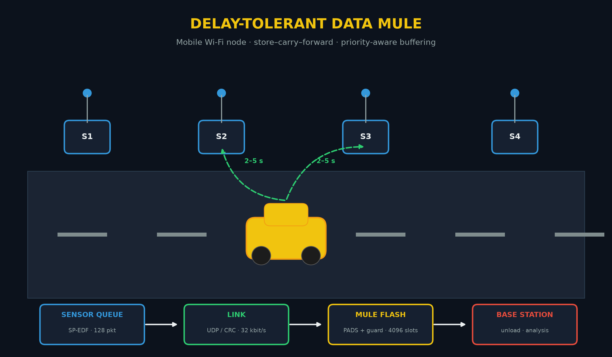
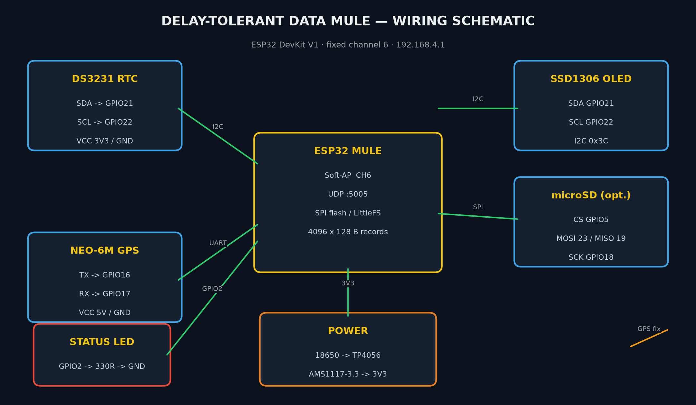
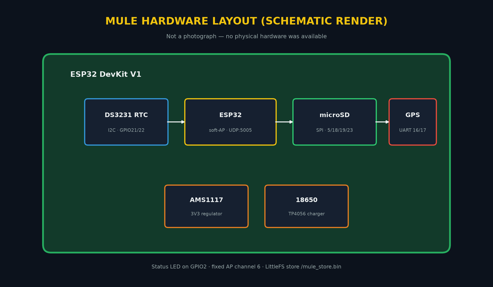
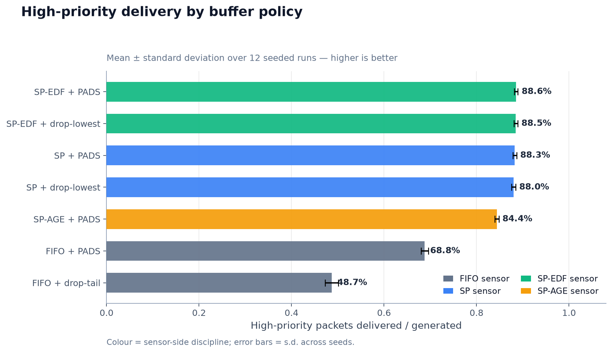
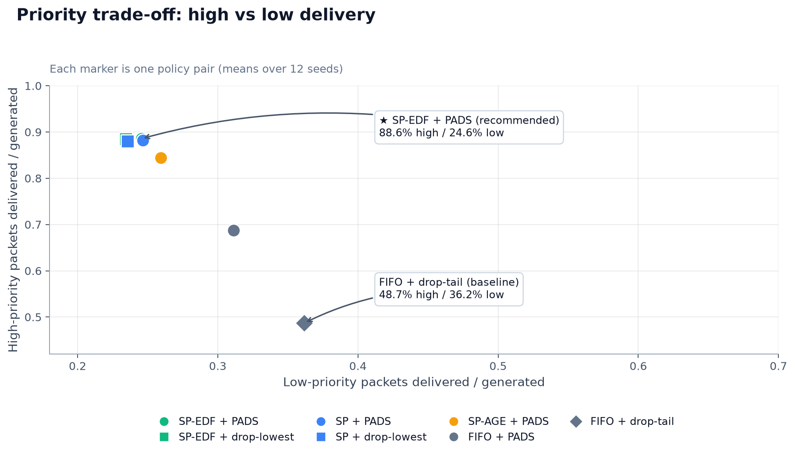

# Delay-Tolerant Data Mule Node

### Collecting remote field data with a mobile Wi-Fi node

[](https://www.espressif.com/)
[](https://www.arduino.cc/)
[](https://www.python.org/)
[](#limitations)
[](LICENSE)

A remote field sensor has no network. This project puts a store-and-forward
gateway on a moving platform: an **ESP32 data mule** drives past each sensor,
collects buffered readings during a 2–5 second Wi-Fi pass, writes them to flash,
and later unloads them at a base station. No end-to-end path ever needs to
exist.

The central research question is:

> **What buffer management policy maximizes high-priority sensor packet
> delivery during brief passes?**

**Answer:** strict priority with *earliest-deadline-first* inside the high class
on the sensor, combined with **PADS** on the mule (expired-record purge,
deadline-aware admission, a high-priority guard band, and priority-aware
eviction). In 84 seeded simulation runs it delivered **88.6 %** of alerts
versus **48.7 %** for FIFO + drop-tail — an **82 % relative improvement**.

---

## Demonstrations

**Project walkthrough:** [Watch the full explanation](https://drive.google.com/file/d/1kPUErmg06S_vVMQRKt5njrpGF7Z_qzOo/view)

This recording explains the problem, architecture, policies, simulation results,
and deliverables.

A **Blender 3D simulation** is available in `simulation/`: a scripted
scene of the vehicle passing four sensor nodes, with Wi-Fi contact beams,
packet transfer, backlog bars, and a live flash-slot visualisation. Rendered
output: [`simulation/output/mule_3d.mp4`](simulation/output/mule_3d.mp4). See
[`simulation/README.md`](simulation/README.md).



*The still above is a frame from the rendered 3D animation; it is a schematic
visualisation, not a photograph of hardware.*

There is also an **interactive browser simulator** at
[`demo/interactive_simulator.html`](demo/interactive_simulator.html). Open it
directly in a browser — no install or server needed. It lets you inject P0
alerts, flood the queues with low-priority traffic, switch buffer policies,
trigger mule passes, and watch the handshake, flash map, eviction log, and live
KPIs. See [`demo/README.md`](demo/README.md) for details.

> This interactive demo is a didactic model, not the validated experiment. The
> measured results in this README come from `simulator/dtn_sim.py`.

---

## System overview



*Rendered architecture diagram — not a photograph. See
[`docs/images/README.md`](docs/images/README.md).*

```text
 Sensor node                    Mule (mobile)                     Base station
 ┌──────────────┐              ┌─────────────────────┐          ┌────────────┐
 │ sample       │   UDP 5005   │ soft-AP 192.168.4.1 │  unload  │ archive &  │
 │ priority     │ ───────────► │ DHP-1 handshake     │ ───────► │ analyse    │
 │ SP-EDF queue │  2–5 s pass  │ RAM index + PADS    │          │            │
 │ 128 packets  │ ◄─────────── │ flash 4096 records  │          └────────────┘
 └──────────────┘   ACK bitmap └─────────────────────┘
```

### Key features

- **Dynamic five-phase handshake** (`HELLO → SUMMARY → REQ → DATA → ACK/DONE`)
  with RSSI-driven degradation: a weak signal switches to HIGH-only requests.
- **Two-level buffer policy** — priority/EDF on the sensor, PADS on the mule.
- **Durable storage** — fixed 128-byte flash slots, CRC-32 per record,
  store-before-ACK, and startup index rebuild with torn-record repair.
- **Store-carry-forward** — the mule never needs simultaneous connectivity to
  a sensor and the base station.
- **Reproducible evaluation** — 84 seeded runs, sensitivity sweep, and CSV/PNG
  artefacts generated by one script.

---

## Repository structure

```
.
├── README.md                     ← this file
├── LICENSE                       MIT
├── proposal_analysis.pdf         ← original proposal + final analysis (Moodle)
├── docs/
│   ├── 01_buffer_policy.md       ★ policy question, evidence, recommendation
│   ├── 02_hardware.md            BOM, wiring, assembly
│   ├── 03_protocol.md            DHP-1 handshake specification
│   ├── 05_proposal.md            original proposal
│   ├── 06_analysis.md            outcome analysis
│   ├── images/                   renders, wiring PNG/SVG, generator scripts
│   └── make_pdf.py               builds proposal_analysis.pdf
├── firmware/
│   ├── common/                   shared packet format + config
│   ├── sensor/                   sensor node sketch and queue
│   └── mule/                     mule sketch, flash store, eviction, handshake
├── simulator/
│   ├── dtn_sim.py                ★ discrete-event comparison
│   ├── requirements.txt
│   └── results/                  CSVs and figures from the 12-seed run
├── demo/
│   ├── interactive_simulator.html  ★ clickable browser demo (no install)
│   └── README.md
├── simulation/
│   ├── blender_mule.py           ★ Blender 3D scene generator
│   ├── output/mule_3d.mp4        rendered 3D animation
│   ├── output/mule_3d.blend      editable Blender scene
│   └── README.md
└── 3d/enclosure.scad             optional parametric weatherproof enclosure
```

---

## Quick start

### 1. Explore the result without hardware

```bash
cd delay-tolerant-data-mule/simulator
python -m pip install -r requirements.txt
python dtn_sim.py --cycles 32 --seeds 12 --outdir results
```

Open `results/figures/01_high_delivery.png` and `results/summary.csv`.
Typical runtime is under a minute.

### 2. Build the firmware

1. Install Arduino IDE 2.x and the `esp32:esp32` boards package.
2. Copy `firmware/common/*.h` into both the `sensor/` and `mule/` sketch folders
   (or add `common/` as an include path).
3. Open `firmware/sensor/sensor.ino`; set `SENSOR_ID` and, optionally,
   `SENSOR_POLICY` (`SP_EDF` is the default and recommended).
4. Open `firmware/mule/mule.ino`; it defaults to `PADS` eviction.
5. Select **ESP32 Dev Module**, upload, and open the serial monitor at 115200.

Full instructions: [`firmware/README.md`](firmware/README.md).

### 3. Replicate the experiment

All parameters live in the `Config` dataclass at the top of
`simulator/dtn_sim.py`. Change `seeds` or `cycles` on the command line, or edit
`Config` to model a different link rate, pass duration, or flash size. The
firmware's matching constants are in `firmware/common/config.h`.

---

## Hardware

| Item | Quantity | Purpose |
|------|----------|---------|
| ESP32 DevKit V1 | 2+ | one mule, one per sensor |
| DS3231 RTC | 1 | epoch time across power loss |
| NEO-6M GPS (optional) | 1 | contact geotagging |
| microSD module (optional) | 1 | secondary archive |
| SSD1306 OLED (optional) | 1 | status display |
| 18650 + TP4056 + AMS1117-3.3 | 1 | portable power |
| IP65 enclosure + vehicle mount | 1 | weather and mechanical protection |

BOM, pin map, assembly notes, and the wiring diagram are in
[`docs/02_hardware.md`](docs/02_hardware.md).





*Both images are rendered schematic illustrations, not photographs of a built
system.*

### 3D model and simulation

An optional parametric enclosure is included at
[`3d/enclosure.scad`](3d/enclosure.scad), with mounting bosses for the DevKit,
gland holes, and a separate lid. Render with OpenSCAD:

```bash
openscad -o docs/images/enclosure.png 3d/enclosure.scad
```

A scripted **Blender simulation** of the full mule pass — vehicle, four sensor
nodes, Wi-Fi contact beams, packet transfer, backlog bars, and flash-slot
occupancy — lives in [`simulation/`](simulation/README.md), with both a
rendered MP4 and an editable `.blend` scene.

---

## Results

| Policy | High delivery | Low delivery | Overall | Jain fairness |
|--------|--------------:|-------------:|--------:|--------------:|
| **SP-EDF + PADS** | **0.886 ± 0.004** | 0.246 | **0.405** | **0.998** |
| SP + PADS | 0.883 ± 0.004 | 0.247 | **0.405** | 0.998 |
| SP-AGE + PADS | 0.844 ± 0.005 | **0.259** | **0.405** | 0.995 |
| FIFO + PADS | 0.688 ± 0.008 | 0.311 | **0.405** | 0.939 |
| FIFO + DROP_TAIL | 0.487 ± 0.014 | 0.362 | 0.393 | 0.858 |





Full interpretation, including the pass-duration sensitivity sweep, is in
[`docs/01_buffer_policy.md`](docs/01_buffer_policy.md). Raw data:
[`simulator/results/`](simulator/results/).

**Two lessons worth highlighting:**

1. Total delivery is almost constant (~0.405) across efficient policies — the
   policy decides *which* packets survive, not how many bytes move.
2. Longer passes do not rescue FIFO. With drop-tail, high-priority delivery
   *fell* from 0.485 at 3.5 s to 0.373 at 7 s because bulk traffic filled the
   flash before later alerts arrived.

---

## Deliverables map

| Requirement | Location |
|-------------|----------|
| GitHub documentation | this repository |
| Project layout | plain file tree, documented in the structure above |
| README with setup, usage, outcomes | this file |
| Photos and schematics | `docs/images/` (rendered diagrams, clearly labelled) + `docs/02_hardware.md` |
| Controller code | `firmware/` |
| 3D model | `3d/enclosure.scad` |
| 3D simulation | `simulation/blender_mule.py`, `simulation/output/mule_3d.mp4` + `.blend` |
| Interactive demo | `demo/interactive_simulator.html` (open in a browser) |
| Original proposal + analysis | `proposal_analysis.pdf` (Moodle upload) |

## Limitations

This project had **no physical ESP32 hardware available**. Firmware is
compile-ready and fully documented, and the policies are validated by a
seeded simulator that shares the same constants and score functions, but
radio timing, 802.11 contention, association delay, and flash wear were not
measured on a device. All performance numbers are explicitly labelled as
simulation results. See [`docs/06_analysis.md`](docs/06_analysis.md) for the full
reflection and proposed hardware-in-the-loop follow-up.

## License

[MIT](LICENSE) — see `LICENSE` for details.
