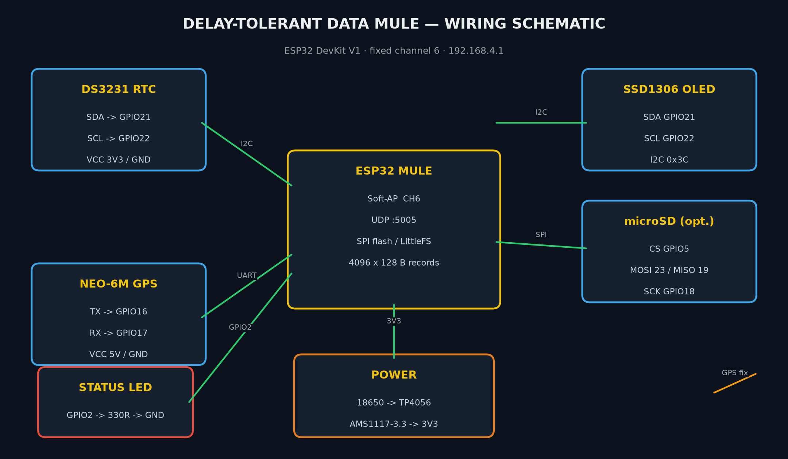
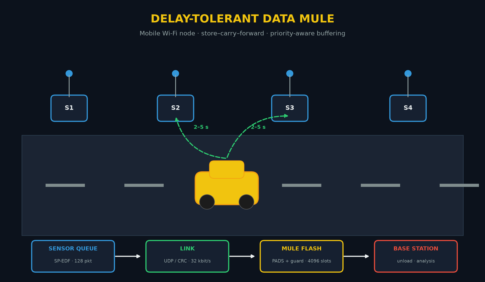
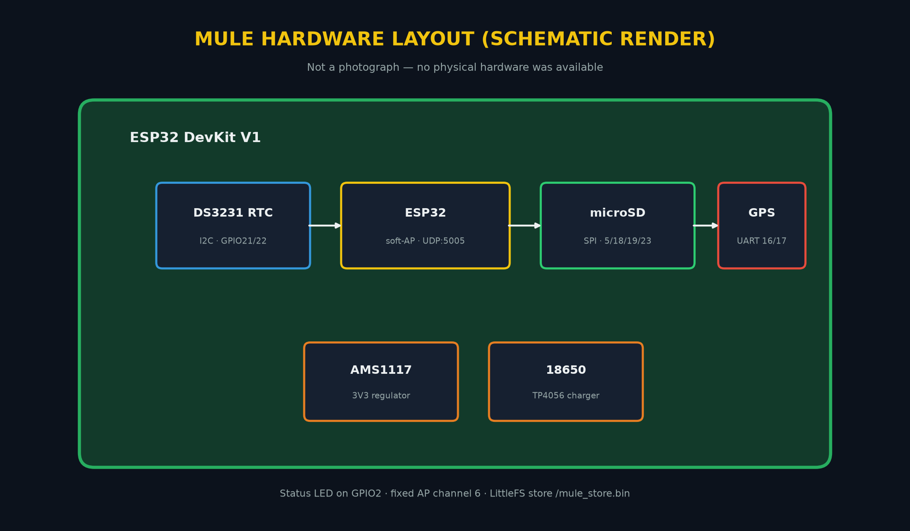

# Hardware, Schematic and Assembly

> **Status note:** this build was validated in simulation because no physical
> ESP32 hardware was available. The circuit below is a complete, buildable
> reference design; the generated render in `docs/images/` illustrates the
> intended assembly and is labelled as a render, not a photograph.

## 1. Bill of materials

| # | Component | Qty | Notes |
|---|-----------|-----|-------|
| 1 | ESP32 DevKit V1 (30-pin) | 2+ | One mule, one per sensor node |
| 2 | 4 MB SPI flash / LittleFS (onboard) | 1 | Used by the mule for record storage |
| 3 | microSD module + card (optional) | 1 | Secondary bulk archive, 8–32 GB |
| 4 | DS3231 RTC module | 1 | Keeps epoch time across power loss |
| 5 | NEO-6M GPS module (optional) | 1 | Geotags each contact for route logging |
| 6 | SSD1306 OLED 0.96" (optional) | 1 | Mule status display |
| 7 | TP4056 Li-ion charger + 18650 | 1 | 3.7 V supply with protection |
| 8 | AMS1117-3.3 regulator | 1 | 5 V → 3.3 V if not using powered USB |
| 9 | LEDs, resistors, pushbuttons | – | Status indicators and reset |
| 10 | IP65 enclosure + cable glands | 1 | Weather protection |
| 11 | Vehicle mount (magnetic or RAM ball) | 1 | Roof/dashboard mounting |

## 2. Wiring diagram

```text
                         +---------------------------+
                         |        ESP32 MULE         |
                         |   (soft-AP 2.4 GHz CH6)   |
                         +-------------+-------------+
                                       |
     +-----------------+                | SPI / LittleFS (onboard flash)
     |   DS3231 RTC    |                v
     |  VCC  3V3 <-----+----------------+3V3
     |  GND  GND <-----+----------------+GND
     |  SDA  GPIO21 <--+----------------+21
     |  SCL  GPIO22 <--+----------------+22
     +-----------------+                |
                                       | microSD (optional)
     +-----------------+                | CS   -> GPIO5
     |  NEO-6M GPS     |                | MOSI -> GPIO23
     |  TX -> GPIO16 <--+----------------+16
     |  RX <- GPIO17 ---+----------------+17
     |  VCC 5V, GND     |
     +-----------------+

     +-----------------+                | STATUS
     |   SSD1306 OLED  |                | GPIO2 -> 330R -> LED -> GND
     |  SDA GPIO21, SCL GPIO22          v
     +-----------------+

  Power: 18650 -> TP4056 -> AMS1117-3.3 -> ESP32 VIN/3V3, common GND
```



A vector version is provided as `images/wiring_diagram.svg`, and as a PNG for
viewers without SVG support. Both are generated from
`images/make_wiring.py`.





The last two images are rendered schematic illustrations, not photographs.

## 3. Sensor node wiring

```text
  ESP32 sensor
    GPIO34 (ADC) <-- analog sensor output (soil moisture / water level)
    GPIO2        --> status LED (blink = sampling, solid = contact)
    GPIO21/22    --> I2C sensor bus (optional)
    VIN 5V, GND     common with sensor and battery pack
```

## 4. Assembly notes

1. Flash the firmware **before** mounting in the enclosure; the USB port is
   covered by the weatherproof lid.
2. Keep the ESP32 antenna at least 2 cm from the metal vehicle roof; a ground
   plane beneath the board is acceptable but an antenna overhang is better.
3. Use a dedicated 3.3 V regulator: brownouts during Wi-Fi TX are the most
   common cause of dropped records in the field.
4. The mule's AP should use a fixed channel (6) and a fixed IP so sensors never
   scan or run DHCP during a pass.
5. Battery: a 2600 mAh 18650 gives roughly 8–12 h of continuous mule operation
   with the radio in soft-AP mode.

## 5. Mechanical design

An optional parametric enclosure is provided in `3d/enclosure.scad`. It includes
mounting bosses for the DevKit, a slot for the microSD card, and cable gland
holes. Render it with OpenSCAD:

```bash
openscad -o docs/images/enclosure.png 3d/enclosure.scad
```
